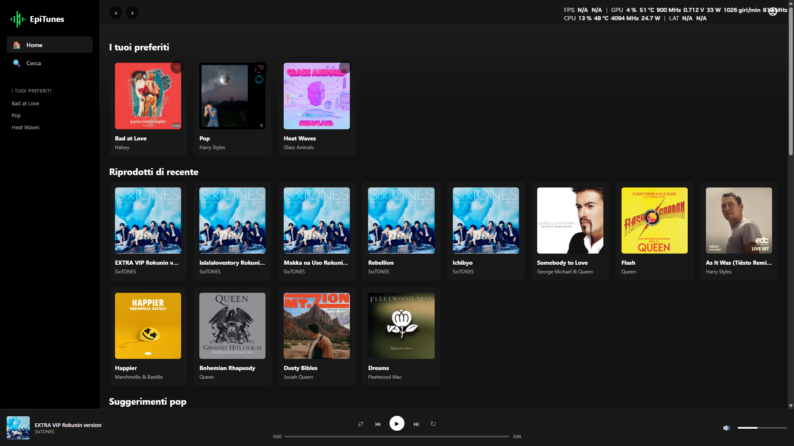
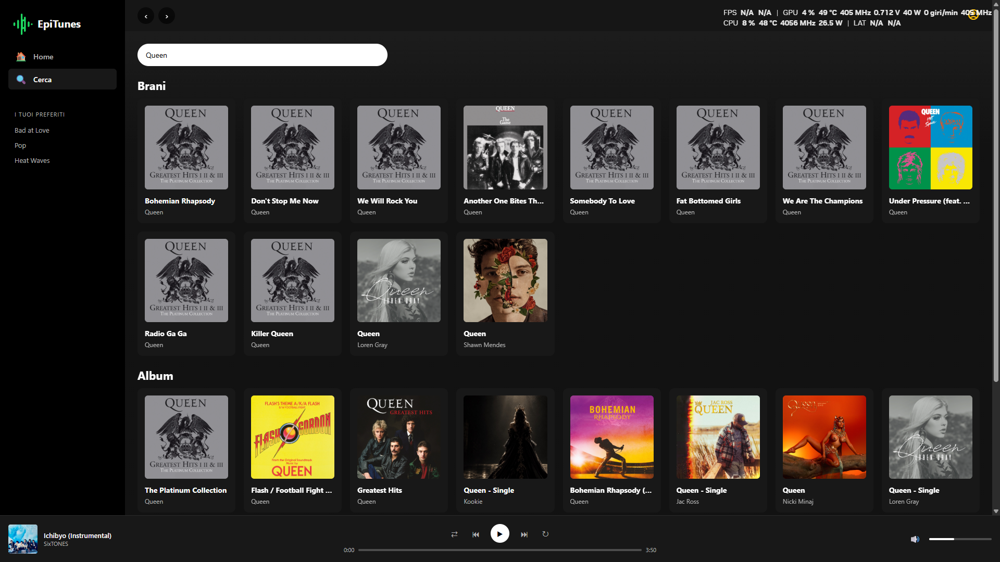
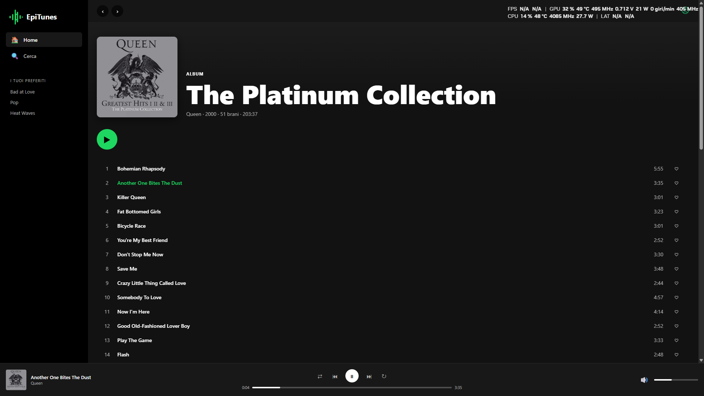
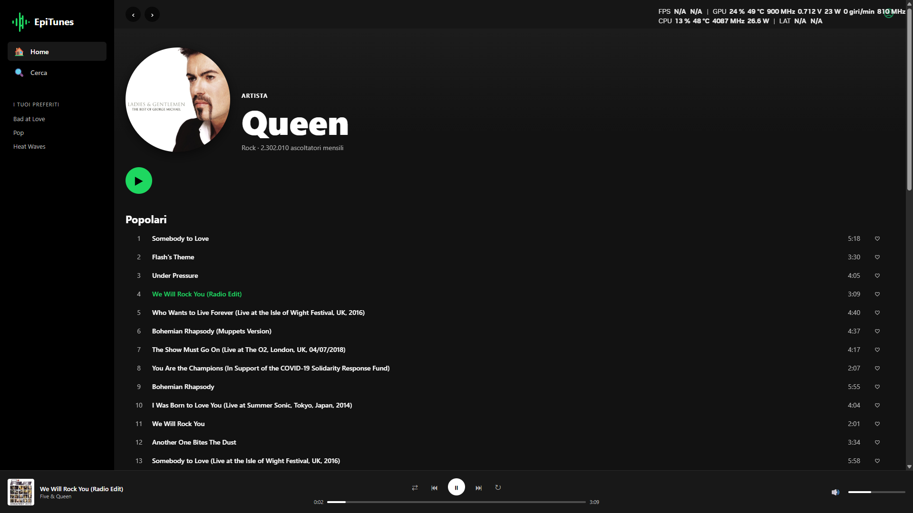
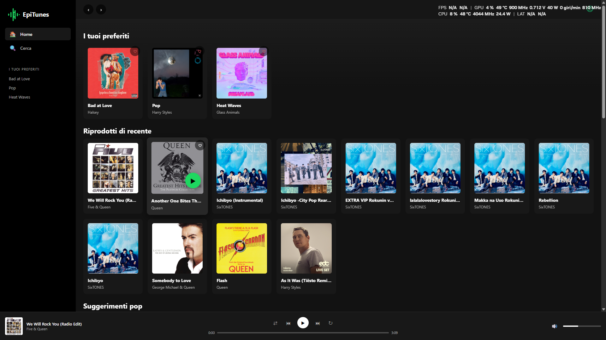

# EpiTunes - Web player musicale &nbsp; 
# Progetto realizzato dal Team 1 &nbsp; 


Questa repository contiene il codice sorgente di **EpiTunes**, un'applicazione web ispirata a Spotify e sviluppata per **EPICODE** durante la Build Week 2. 
L'app usa la **iTunes Search API** per cercare brani, album e artisti e riprodurne le anteprime audio.

**Stato del progetto:** in fase di sviluppo. Questo file viene aggiornato man mano che il progetto viene realizzato.

**Sito online:** _da compilare con il link di GitHub Pages_

## Indice

1. [Funzionalità](#funzionalità)
2. [Anteprima](#anteprima)
3. [Tecnologie utilizzate](#tecnologie-utilizzate)
4. [Come eseguire il progetto in locale](#come-eseguire-il-progetto-in-locale)
5. [Struttura del progetto](#struttura-del-progetto)
6. [Architettura](#architettura)
7. [Albero del DOM](#albero-del-dom)
8. [Come funziona](#come-funziona)
9. [Implementazioni JavaScript](#implementazioni-javascript)
10. [Convenzioni di codice](#convenzioni-di-codice)
11. [Il Team 1 e il flusso di lavoro](#il-team-1-e-il-flusso-di-lavoro)

---

## Funzionalità

L'applicazione è divisa in tre zone fisse (sidebar, contenuto, player) e quattro pagine:

1. **Home** (`index.html`)
2. **Cerca** (`search.html`)
3. **Album** (`album.html`)
4. **Artista** (`artist.html`)

### Funzionalità principali

- **Player audio:** riproduzione delle anteprime musicali di 30 secondi, con controlli Play/Pausa, brano precedente e successivo.
- **Coda di riproduzione:** gestione sequenziale dei brani in base alla sezione musicale selezionata.
- **Shuffle e Repeat:** riproduzione casuale e ripetizione dei brani.
- **Barra di avanzamento interattiva:** possibilità di spostarsi in qualsiasi punto dell'anteprima musicale.
- **Controllo del volume:** regolazione tramite click o trascinamento del mouse e attivazione/disattivazione della modalità muto.
- **Ultimo brano ripristinato:** recupero dell'ultimo brano ascoltato al caricamento della pagina.
- **Ricerca con debounce:** avvio della ricerca 400 ms dopo l'ultima digitazione, evitando richieste API non necessarie.
- **Richieste in parallelo:** ricerca simultanea di brani, album e artisti attraverso `Promise.all()`.
- **Persistenza della ricerca:** salvataggio e ripristino dell'ultima ricerca effettuata.
- **Gestione dei risultati:** visualizzazione dinamica delle sezioni e dei messaggi in assenza di risultati.
- **Preferiti:** aggiunta e rimozione dei brani, sincronizzazione dei cuori e aggiornamento dinamico della sidebar.
- **Accesso rapido ai preferiti:** collegamento diretto dalla sidebar alla sezione dei preferiti nella Home.
- **Cronologia:** memorizzazione degli ultimi 12 brani ascoltati, senza duplicati.
- **Pagine di dettaglio:** visualizzazione delle informazioni relative ad album e artisti, con le rispettive liste di brani riproducibili.
- **Navigazione:** pulsanti Avanti e Indietro per spostarsi tra le pagine precedentemente visitate.
- **Persistenza dei dati:** utilizzo di `localStorage` per conservare preferiti, cronologia e ultima ricerca.
- **Interfaccia dinamica:** aggiornamento dei controlli del player ed evidenziazione del brano in riproduzione.
- **Design responsive:** interfaccia adattabile a differenti dimensioni dello schermo.
- **Dark theme:** interfaccia grafica ispirata a Spotify, con animazioni, transizioni ed effetti hover.

## Anteprima

## 📸 Screenshots

### Home 


### Ricerca


### Pagina Album


### Pagina Artista


### Player musicale


## Tecnologie utilizzate

- **HTML5:** struttura delle quattro pagine.
- **CSS3:** stile e layout.
- **Bootstrap 5.3.9:** framework CSS utilizzato per il layout responsive, i componenti grafici e le classi di utilità, integrato con stili CSS personalizzati.
- **JavaScript (ES6+):** logica dell'applicazione.
- **iTunes Search API:** dati e anteprime audio, gratuita e senza chiave.
- **Fetch API con `async/await`:** richieste all'API, con gestione degli errori in `try/catch`.
- **localStorage:** cronologia, preferiti e ultima ricerca.

## Come eseguire il progetto in locale

**1. Clona il repository:**

```bash
git clone _da compilare con l'URL della repo_
```

**2. Apri l'applicazione:** apri `index.html` con **Live Server** su VS Code. Serve una connessione a internet per i dati di iTunes.

## Struttura del progetto

```text
.
├── index.html              # Home
├── search.html             # Ricerca
├── album.html              # Dettaglio album
├── artist.html             # Dettaglio artista
├── README.md
└── assets/
    ├── css/
    │   └── app.css         # Stile
    ├── img/                # Immagini
    └── js/
        ├── common.js       # Codice condiviso da tutte le pagine
        ├── home.js         # Home
        ├── search.js       # Ricerca
        ├── album.js        # Pagina album
        └── artist.js       # Pagina artista
```

## Architettura

Ogni pagina carica prima `common.js` e poi il proprio script.

- **Classi modello:** `Track`, `Album` e `Artist` ricevono un risultato grezzo dell'API (`raw`) e lo trasformano in un oggetto con nomi brevi e uniformi (`id`, `title`, `artist`, `cover`…). Tutti i dati di iTunes passano da queste classi.
- **Classe `Player`:** gestisce l'elemento `<audio>` e il footer. Tiene in memoria il brano corrente (`currentTrack`) e lo stato di riproduzione (`isPlaying`).
- **Helpers:** `fetchJSON()` fa le richieste e, in caso di errore, restituisce un risultato vuoto senza bloccare la pagina; `bigArt()` ingrandisce le copertine da 100×100 a 600×600; `formatTime()` converte i millisecondi in `m:ss`; `debounce()` ritarda la ricerca.
- **localStorage:** `readArray()` legge un array in modo sicuro; `getHistory()`, `addToHistory()`, `getFavourites()`, `isFavourite()` e `toggleFavourite()` gestiscono cronologia e preferiti.
- **Componenti riutilizzabili:** `createTrackCard()` crea la card di un brano, con i suoi click, ed è usata da Home e Cerca.
- **Avvio:** `initPage()` disegna la sidebar, monta il player e lo restituisce alla pagina.
- **Pagine:** ogni script legge i dati (dall'API, dal localStorage o dall'id nell'indirizzo), crea gli elementi con `createElement` e li aggiunge alla pagina.

## Albero del DOM

L'applicazione presenta una struttura modulare, composta da elementi
condivisi tra le diverse pagine e componenti generati dinamicamente
attraverso JavaScript.

### Struttura generale

Layout condiviso da tutte le pagine dell'applicazione.

```html
<body>
    <div class="app">
        <aside class="sidebar"></aside>

        <main class="main">
            <header class="topbar"></header>
            <section><!-- Contenuto della pagina --></section>
        </main>

        <footer class="player"></footer>
    </div>

    <audio></audio>
</body>
```

### Sidebar

Generata dinamicamente in `common.js` attraverso le funzioni `renderSidebar()` e `renderSidebarFavourites()`.

```html
<aside class="sidebar">
    <div class="brand">
        <div class="brand-mark">
            
        </div>
        <span class="brand-text"></span>
    </div>

    <nav class="sidebar-nav">
        <a>
            <span class="ico"></span>
            <span>Home</span>
        </a>
        <a>
            <span class="ico"></span>
            <span>Cerca</span>
        </a>
    </nav>

    <p class="sidebar-section-title">I tuoi preferiti</p>

    <ul class="sidebar-list">
        <li>
            <a></a>
        </li>
    </ul>
</aside>
```

### Topbar

Barra di navigazione condivisa, contenente i pulsanti di navigazione, il campo di ricerca e l'icona utente.

```html
<header class="topbar">
    <div class="topbar-nav">
        <button class="nav-btn">‹</button>
        <button class="nav-btn">›</button>
    </div>

    <div class="topbar-search">
        <input class="search-input">
    </div>

    <div>
        <span class="avatar"></span>
    </div>
</header>
```

### Player musicale

Generato dinamicamente in `common.js` attraverso il metodo `mount()` della classe `Player`.

```html
<footer class="player">

    <div class="player-track">
        <div class="player-cover">
            
        </div>
        <div class="player-meta">
            <p class="player-title"></p>
            <p class="player-artist"></p>
        </div>
    </div>

    <div class="player-center">
        <div class="player-controls">
            <button class="btn-ctrl">⇄</button>
            <button class="btn-ctrl">⏮</button>
            <button class="btn-play">▶</button>
            <button class="btn-ctrl">⏭</button>
            <button class="btn-ctrl">↻</button>
        </div>

        <div class="player-progress">
            <span>0:00</span>
            <div class="progress-bar">
                <div class="progress-fill"></div>
            </div>
            <span>0:00</span>
        </div>
    </div>

    <div class="player-right">
        <button class="btn-ctrl">🔊</button>
        <div class="volume-bar">
            <div class="volume-fill"></div>
        </div>
    </div>

</footer>
```

---

## Struttura delle pagine

### Home — `index.html`

Le sezioni vengono generate dinamicamente attraverso la funzione `renderRow()` presente in `home.js`.

```html
<section class="home">

    <section class="row">
        <h2>I tuoi preferiti</h2>
        <div class="grid">
            <div class="card">...</div>
        </div>
    </section>

    <section class="row">
        <h2>Riprodotti di recente</h2>
        <div class="grid">
            <div class="card">...</div>
        </div>
    </section>

    <section class="row">
        <h2>Suggerimenti pop</h2>
        <div class="grid">
            <div class="card">...</div>
        </div>
    </section>

    <section class="row">
        <h2>Suggerimenti rock</h2>
        <div class="grid">
            <div class="card">...</div>
        </div>
    </section>

    <section class="row">
        <h2>Suggerimenti hits</h2>
        <div class="grid">
            <div class="card">...</div>
        </div>
    </section>

</section>
```

Le sezioni dei preferiti e dei brani riprodotti di recente vengono visualizzate solamente quando contengono degli elementi.

### Ricerca — `search.html`

La struttura HTML contiene tre sezioni dedicate ai risultati della ricerca, popolate dinamicamente attraverso `search.js`.

```html
<section class="search">

    <div class="search-box">
        <input class="search-input">
    </div>

    <p><!-- Messaggio di errore --></p>

    <div class="search-results">

        <section class="row">
            <h2>Brani</h2>
            <div class="grid">
                <div class="card">...</div>
            </div>
        </section>

        <section class="row">
            <h2>Album</h2>
            <div class="grid">
                <div class="card">...</div>
            </div>
        </section>

        <section class="row">
            <h2>Artisti</h2>
            <div class="grid">
                <div class="card">...</div>
            </div>
        </section>

    </div>

</section>
```

### Dettaglio album — `album.html`

La pagina viene popolata dinamicamente attraverso le funzioni `renderAlbumHero()` e `rendertracklist()` presenti in `album.js`.

```html
<section class="album-page">

    <div class="album-hero">
        <div class="album-cover">
            
        </div>

        <div class="hero-meta">
            <p class="hero-kicker">ALBUM</p>
            <h1 class="hero-title"></h1>
            <p class="hero-sub"></p>
        </div>
    </div>

    <div class="hero-actions">
        <button class="btn-play-big">▶</button>
    </div>

    <div class="tracklist">
        <div class="track-row">
            <p class="track-num"></p>
            <h3 class="track-title"></h3>
            <p class="track-time"></p>
            <button class="track-fav">♡</button>
        </div>
    </div>

</section>
```

### Dettaglio artista — `artist.html`

La pagina viene popolata dinamicamente attraverso le funzioni `renderArtistHero()` e `renderTopTracks()` presenti in `artist.js`.

```html
<section class="artist-page">

    <div class="artist-hero">
        <div class="album-cover">
            
        </div>

        <div class="hero-meta">
            <p class="hero-kicker">ARTISTA</p>
            <h1 class="hero-title"></h1>
            <p class="hero-sub"></p>
        </div>
    </div>

    <div class="hero-actions">
        <button class="btn-play-big">▶</button>
    </div>

    <div class="top-tracks">
        <h2>Popolari</h2>

        <div class="track-row">
            <p class="track-num"></p>
            <h3 class="track-title"></h3>
            <p class="track-time"></p>
            <button class="track-fav">♡</button>
        </div>
    </div>

</section>
```

---

## Componenti dinamici e riutilizzabili

### Track Card

Componente condiviso tra Home e Ricerca, generato attraverso la funzione `createTrackCard()` presente in `common.js`.

```html
<div class="card">
    <div class="card-image-wrap">
        
    </div>

    <button class="card-play">▶</button>
    <button class="card-fav">♡</button>

    <p class="card-title"></p>
    <a class="card-sub"></a>
</div>
```

### Album Card

Generata attraverso la funzione `renderAlbumCard()` presente in `search.js`.

```html
<div class="card">
    <div class="card-image-wrap">
        
    </div>

    <p class="card-title"></p>
    <p class="card-sub"></p>
</div>
```

### Artist Card

Generata attraverso la funzione asincrona `renderArtistCard()` presente in `search.js`.

```html
<div class="card">
    <div class="card-image-wrap round">
        
    </div>

    <p class="card-title"></p>
    <p class="card-sub"></p>
</div>
```

### Track Row

Struttura condivisa dalle pagine di dettaglio Album e Artista utilizzata per rappresentare i singoli brani.

```html
<div class="track-row">
    <p class="track-num"></p>
    <h3 class="track-title"></h3>
    <p class="track-time"></p>
    <button class="track-fav">♡</button>
</div>
```

> Le strutture HTML riportate rappresentano il DOM finale dopo
> l'esecuzione di JavaScript. Per una maggiore leggibilità sono
> stati omessi gli ID, gli attributi, le classi di utilità Bootstrap
> e le classi di stato dinamiche.

## Come funziona

### 1. Home 🏠

- `loadHome()` esegue in parallelo, attraverso `Promise.all()`, tre richieste di suggerimenti musicali (pop, rock e hits), trasformando i risultati in istanze della classe `Track`.
- `renderRow()` genera dinamicamente una sezione composta da un titolo e una griglia di card.
- Le sezioni dedicate alla cronologia e ai preferiti vengono visualizzate solamente se contengono dei brani.
- `renderFavouritesRow()` aggiorna dinamicamente la sezione dei preferiti attraverso l'evento personalizzato `favouritesUpdated`, senza ricaricare la pagina.
- Al click su una card musicale viene avviata la riproduzione del brano e impostata la relativa coda di riproduzione.
- Al click sul nome dell'artista si accede alla sua pagina di dettaglio.

### 2. Cerca 🔎

- La funzione `debounce()` ritarda l'esecuzione di `doSearch()` di 400 ms dall'ultima digitazione, evitando richieste API non necessarie.
- `doSearch()` esegue tre richieste in parallelo attraverso `Promise.all()`, ricercando brani, album e artisti.
- I risultati vengono trasformati in istanze delle classi `Track`, `Album` e `Artist`.
- Le card vengono generate dinamicamente e vengono mostrate solamente le sezioni contenenti risultati.
- In assenza di risultati viene visualizzato un messaggio informativo.
- L'ultima ricerca viene salvata in `localStorage` e ripristinata al caricamento della pagina.
- Al click su un brano viene avviata la riproduzione e impostata la coda dei risultati musicali.
- Al click su un album o un artista si accede alla relativa pagina di dettaglio, passando l'identificativo attraverso l'URL.

### 3. Album 💿

- L'identificativo dell'album viene recuperato dall'URL attraverso `URLSearchParams`.
- La richiesta `lookup?id=...&entity=song` restituisce le informazioni dell'album e l'elenco dei relativi brani.
- I risultati vengono trasformati in istanze delle classi `Album` e `Track`.
- `renderAlbumHero()` genera la sezione introduttiva contenente copertina, titolo, artista, anno di pubblicazione, numero di brani e durata complessiva.
- L'anno viene ricavato attraverso `getFullYear()`, mentre la durata complessiva viene calcolata attraverso `reduce()`.
- `rendertracklist()` genera dinamicamente la lista dei brani dell'album.
- I brani vengono inseriti nella coda di riproduzione attraverso `setQueue()`.
- Il pulsante Play principale avvia il primo brano dell'album, mentre il click su una singola riga avvia il brano selezionato.
- Il pulsante a forma di cuore permette di aggiungere o rimuovere un brano dai preferiti.

### 4. Artista 🎤

- L'identificativo dell'artista viene recuperato dall'URL attraverso `URLSearchParams`.
- La richiesta `lookup?id=...&entity=song&limit=15` recupera le informazioni dell'artista e i relativi brani.
- I risultati vengono trasformati in istanze delle classi `Artist` e `Track`.
- `renderArtistHero()` genera la sezione introduttiva contenente immagine, nome, genere musicale e ascoltatori mensili.
- Poiché l'API utilizzata non restituisce direttamente una foto dell'artista, viene utilizzata la copertina del primo brano disponibile.
- Il numero di ascoltatori mensili viene simulato attraverso `Math.random()` e formattato con `toLocaleString("it-IT")`.
- `renderTopTracks()` genera dinamicamente la sezione "Popolari".
- Il pulsante Play principale imposta la coda e avvia il primo brano.
- Il click su una singola riga imposta la coda e avvia il brano selezionato.
- Ogni brano può essere aggiunto o rimosso dai preferiti.

### 5. Player musicale 🎧

Il player è gestito attraverso la classe `Player`, presente in `common.js`, ed è condiviso da tutte le pagine dell'applicazione.

#### Riproduzione audio 

- `mount()` genera dinamicamente l'intera struttura del footer e inizializza i controlli del player.
- `play(track)` imposta l'anteprima musicale come sorgente dell'elemento `<audio>`, aggiorna le informazioni del brano nel footer e lo aggiunge alla cronologia.
- `togglePlay()` alterna lo stato di riproduzione e pausa, aggiornando dinamicamente l'icona del pulsante.
- L'evento `timeupdate` aggiorna in tempo reale la barra di avanzamento e il tempo trascorso.
- L'evento `ended` intercetta la conclusione della riproduzione e gestisce l'aggiornamento dello stato del player.
- `seek()` permette di spostarsi in un punto specifico dell'anteprima musicale attraverso il click sulla barra di avanzamento.

#### Coda di riproduzione

- `trackQueue` contiene l'elenco dei brani appartenenti alla coda di riproduzione corrente.
- `currentIndex` identifica la posizione del brano selezionato all'interno della coda.
- `setQueue()` imposta la coda di riproduzione e il relativo indice iniziale.
- `playFromQueue()` recupera e riproduce un brano attraverso il suo indice.
- `nextTrack()` permette di passare al brano successivo.
- `previousTrack()` permette di tornare al brano precedente.
- La coda viene aggiornata in base alla sezione dalla quale viene selezionato il brano: Home, Ricerca, Album o Artista.

#### Modalità di riproduzione ▶️

- **Play / Pause (▶ / ⏸):** avvia o sospende la riproduzione.
- **Previous (⏮):** torna al brano precedente della coda.
- **Next (⏭):** passa al brano successivo della coda.
- **Shuffle (⇄):** modalità di riproduzione casuale dei brani della coda.
- **Repeat (↻):** modalità di ripetizione della riproduzione sia dello stessa brano, sia dei brani in coda.

#### Gestione del volume 🔊

- `setVolume()` gestisce il volume dell'elemento audio, mantenendo il valore compreso tra 0 e 1 attraverso `Math.min()` e `Math.max()`.
- La barra del volume intercetta la posizione del mouse attraverso `offsetX` e `clientWidth`, calcolando il livello di volume desiderato.
- L'evento `click` permette di impostare direttamente il volume.
- L'evento `mousemove`, combinato con `e.buttons`, permette di regolare il volume trascinando il mouse lungo la barra con il pulsante premuto.
- La larghezza di `volume-fill` viene aggiornata dinamicamente in base al volume impostato.
- Il click sull'icona del volume permette di attivare e disattivare la modalità muto (🔊 / 🔇).
- `previousVolume` memorizza il livello precedente, consentendo di ripristinarlo quando viene disattivata la modalità muto.

#### Aggiornamento dell'interfaccia

- Durante la riproduzione vengono aggiornati dinamicamente copertina, titolo, artista, durata e controlli del player.
- `_updateTrackRows()` individua il brano in riproduzione attraverso il suo identificativo e applica la classe `is-playing` alla riga corrispondente.
- La classe `is-playing` permette di evidenziare graficamente il brano attualmente in riproduzione.
- Al caricamento della pagina, `mount()` recupera l'ultimo brano ascoltato attraverso `getHistory()[0]`, ripristinando le informazioni nel footer senza avviare automaticamente la riproduzione.

### 6. Preferiti e cronologia 

- I dati vengono salvati in `localStorage` sotto forma di array JSON, garantendo la persistenza delle informazioni anche dopo la chiusura o il ricaricamento della pagina.
- `readArray()` gestisce la lettura dei dati salvati, restituendo un array vuoto in caso di dati mancanti o non validi.
- `addToHistory()` rimuove eventuali duplicati, inserisce il brano appena ascoltato all'inizio dell'array e conserva un massimo di 12 brani.
- `isFavourite()` verifica se un determinato brano è già presente tra i preferiti.
- `toggleFavourite()` permette di aggiungere o rimuovere un brano dalla lista dei preferiti.
- L'evento personalizzato `favouritesUpdated` consente di aggiornare dinamicamente le sezioni interessate senza ricaricare la pagina.
- La classe `is-fav` identifica graficamente i brani aggiunti ai preferiti.
- I pulsanti a forma di cuore associati allo stesso brano vengono sincronizzati nelle card attraverso il relativo identificativo.
- `renderSidebarFavourites()` aggiorna dinamicamente l'elenco dei preferiti presente nella sidebar.
- Al click sul titolo di un brano presente nella sidebar, l'utente viene reindirizzato direttamente alla sezione "I tuoi preferiti" della Home attraverso l'ancora `#favourites-row`.

### 7. Navigazione tra le pagine

La navigazione è gestita attraverso la sidebar e la topbar, condivise da tutte le pagine dell'applicazione.

- `renderSidebar()` genera dinamicamente la barra laterale contenente il logo, i collegamenti di navigazione e l'elenco dei preferiti.
- La classe `active` evidenzia la voce di navigazione selezionata.
- Il pulsante Indietro (‹) utilizza `window.history.back()` per tornare alla pagina precedente.
- Il pulsante Avanti (›) utilizza `window.history.forward()` per avanzare nella cronologia di navigazione.
- `initTopbarSearch()` gestisce il campo di ricerca presente nella topbar.
- La ricerca effettuata dalla topbar viene salvata in `localStorage` e, quando necessario, reindirizza l'utente alla pagina `search.html`.
- Nella pagina di ricerca, il campo della topbar è sincronizzato con la ricerca principale.
- La funzione `initPage()` centralizza l'inizializzazione dei componenti condivisi, della navigazione e del player musicale.

### Implementazioni JavaScript

Di seguito vengono riportati alcuni degli snippet più significativi
del progetto, relativi alla gestione delle API, alla programmazione
a oggetti, alla riproduzione musicale e all'aggiornamento dinamico
dell'interfaccia.

#### 1. Gestione delle richieste API

La funzione asincrona `fetchJSON()` centralizza le richieste
all'API di iTunes, gestendo gli errori HTTP e di rete attraverso
`try/catch`.

In caso di errore restituisce un oggetto con risultati vuoti,
evitando di bloccare il funzionamento dell'applicazione.

```javascript
const fetchJSON = async (url) => {
  try {
    const response = await fetch(url);

    if (!response.ok) {
      throw new Error(`Errore HTTP: ${response.status}`);
    }

    return await response.json();

  } catch (error) {
    console.error("Errore fetchJSON:", error);
    return { results: [], resultCount: 0 };
  }
};
```

#### 2. Programmazione a oggetti (OOP)

Le classi `Track`, `Album` e `Artist` permettono di trasformare
i dati grezzi restituiti dall'API in oggetti con proprietà
uniformi, semplificando la gestione delle informazioni.

Esempio della classe `Track`:

```javascript
class Track {
  constructor(raw) {
    this.id = raw.trackId;
    this.title = raw.trackName;
    this.artist = raw.artistName;
    this.album = raw.collectionName;
    this.albumId = raw.collectionId;
    this.artistId = raw.artistId;
    this.cover = raw.artworkUrl100;
    this.previewUrl = raw.previewUrl;
    this.durationMs = raw.trackTimeMillis;
  }
}
```

#### 3. Gestione della coda di riproduzione

La classe `Player` mantiene in memoria un array di brani
(`trackQueue`) e l'indice del brano corrente (`currentIndex`).

Questa struttura permette di gestire la riproduzione sequenziale
e di navigare tra i brani della coda.

```javascript
setQueue(tracks, startIndex = 0) {
  this.trackQueue = tracks;
  this.currentIndex = startIndex;
}

playFromQueue(index) {
  const track = this.trackQueue[index];

  if (!track) return;

  this.currentIndex = index;
  this.play(track);
}

nextTrack() {
  if (this.currentIndex < this.trackQueue.length - 1) {
    this.playFromQueue(this.currentIndex + 1);
  }
}

previousTrack() {
  if (this.currentIndex > 0) {
    this.playFromQueue(this.currentIndex - 1);
  }
}
```

#### 4. Riproduzione e aggiornamento del player

Il metodo `play()` riceve un oggetto `Track`, aggiorna il brano
corrente, imposta la sorgente audio e sincronizza l'interfaccia
grafica con le informazioni del brano selezionato.

Estratto del metodo:

```javascript
play(track) {
  if (!track || !this.audio) return;

  this.currentTrack = track;

  const trackIndex = this.trackQueue.findIndex(
    (item) => Number(item.id) === Number(track.id)
  );

  if (trackIndex !== -1) {
    this.currentIndex = trackIndex;
  }

  this.audio.src = track.previewUrl || "";

  this.audio.play().catch((err) => {
    console.error("Errore riproduzione:", err);
  });

  this.isPlaying = true;

  // Aggiornamento delle informazioni nel footer
  // ...

  addToHistory(track);
  this._updateTrackRows();
}
```

#### 5. Gestione dello stato Play/Pausa

Il metodo `togglePlay()` verifica lo stato dell'elemento audio
e alterna riproduzione e pausa, aggiornando contemporaneamente
lo stato logico e quello grafico del player.

```javascript
togglePlay() {
  if (!this.audio || !this.currentTrack) return;

  if (this.audio.paused) {
    this.audio.play().catch((err) => {
      console.error("Errore ripresa riproduzione:", err);
    });

    this.isPlaying = true;

    if (this.btnToggle) {
      this.btnToggle.textContent = "⏸";
    }

  } else {
    this.audio.pause();
    this.isPlaying = false;

    if (this.btnToggle) {
      this.btnToggle.textContent = "▶";
    }
  }

  this._updateTrackRows();
}
```

#### 6. Aggiornamento della Progress Bar in tempo reale

L'evento `timeupdate` intercetta le variazioni del tempo
di riproduzione dell'elemento audio.

La percentuale di avanzamento viene calcolata attraverso
il rapporto tra il tempo trascorso e la durata complessiva.

```javascript
this.audio.addEventListener("timeupdate", () => {
  const current = this.audio.currentTime || 0;
  const duration = this.audio.duration || 0;

  if (this.timeCurrent) {
    this.timeCurrent.textContent = formatTime(current * 1000);
  }

  if (this.progressFill) {
    const percent = duration > 0
      ? (current / duration) * 100
      : 0;

    this.progressFill.style.width = `${percent}%`;
  }
});
```

#### 7. Navigazione all'interno del brano (Seek)

Il click sulla barra di avanzamento permette di modificare
la posizione corrente della riproduzione.

La posizione del mouse viene rapportata alla larghezza
complessiva della barra.

```javascript
this.progressBar.addEventListener("click", (e) => {
  const barWidth = this.progressBar.clientWidth;

  if (barWidth <= 0) return;

  this.seek(e.offsetX / barWidth);
});
```

Il metodo `seek()` verifica che la durata dell'audio sia valida
e limita il valore ricevuto all'intervallo compreso tra 0 e 1.

```javascript
seek(percent) {
  if (
    !this.audio ||
    !Number.isFinite(this.audio.duration) ||
    this.audio.duration <= 0
  ) {
    return;
  }

  const clamped = Math.max(0, Math.min(1, percent));

  this.audio.currentTime = this.audio.duration * clamped;
}
```

#### 8. Gestione interattiva del volume

Il volume può essere modificato sia attraverso il click
sia trascinando il mouse lungo la barra.

L'evento `mousemove`, combinato con `e.buttons`, permette
di verificare che il pulsante del mouse sia premuto.

```javascript
if (this.volumeBar) {
  const updateVolume = (e) => {
    const barWidth = this.volumeBar.clientWidth;

    if (barWidth <= 0) return;

    this.setVolume(e.offsetX / barWidth);
  };

  this.volumeBar.addEventListener("click", updateVolume);

  this.volumeBar.addEventListener("mousemove", (e) => {
    if (e.buttons !== 1) return;

    updateVolume(e);
  });
}
```

Il metodo `setVolume()` sincronizza il volume effettivo
dell'audio con la larghezza della barra e l'icona del volume.

```javascript
setVolume(v) {
  const clamped = Math.max(0, Math.min(1, v));

  if (this.audio) {
    this.audio.volume = clamped;
  }

  if (this.volumeFill) {
    this.volumeFill.style.width = `${clamped * 100}%`;
  }

  if (this.volumeIcon) {
    this.volumeIcon.textContent = clamped === 0 ? "🔇" : "🔊";
  }
}
```

#### 9. Gestione della modalità Muto

Prima di azzerare il volume, il livello corrente viene
memorizzato nella proprietà `previousVolume`, permettendo
di ripristinarlo al click successivo.

```javascript
this.volumeIcon.addEventListener("click", () => {
  if (this.audio.volume > 0) {
    this.previousVolume = this.audio.volume;
    this.setVolume(0);
  } else {
    this.setVolume(this.previousVolume);
  }
});
```

#### 10. Sincronizzazione grafica del brano in riproduzione

Il metodo `_updateTrackRows()` confronta l'identificativo
del brano corrente con quello associato alle righe della lista.

Attraverso `dataset` e `classList.toggle()` viene evidenziato
solamente il brano attualmente in riproduzione.

```javascript
_updateTrackRows() {
  const rows = document.querySelectorAll(".track-row");

  rows.forEach((row) => {
    const rowTrackId = String(row.dataset.trackId || "");

    const isCurrent =
      this.currentTrack &&
      this.isPlaying &&
      rowTrackId !== "" &&
      rowTrackId === String(this.currentTrack.id);

    row.classList.toggle("is-playing", Boolean(isCurrent));
  });
}
```

#### 11. Persistenza dei dati con localStorage

La funzione `readArray()` centralizza la lettura dei dati
salvati nel browser, gestendo eventuali errori di conversione
JSON attraverso `try/catch`.

```javascript
const readArray = (key) => {
  try {
    const saved = localStorage.getItem(key);

    return saved ? JSON.parse(saved) : [];

  } catch (error) {
    console.error("Errore lettura localStorage:", error);
    return [];
  }
};
```

#### 12. Gestione della cronologia

La cronologia utilizza i metodi degli array `filter()`,
`unshift()` e `slice()` per:

- Eliminare eventuali duplicati.
- Posizionare il brano appena ascoltato all'inizio.
- Conservare solamente gli ultimi 12 brani.

```javascript
const addToHistory = (track) => {
  const filtered = getHistory().filter(
    (t) => Number(t.id) !== Number(track.id)
  );

  filtered.unshift(track);

  const sliced = filtered.slice(0, MAX_HISTORY);

  localStorage.setItem(
    STORAGE_KEY_HISTORY,
    JSON.stringify(sliced)
  );

  window.dispatchEvent(new CustomEvent("historyUpdated"));
};
```

#### 13. Gestione dei preferiti

La funzione `toggleFavourite()` verifica attraverso `some()`
se il brano è già presente tra i preferiti.

L'operatore ternario determina se rimuoverlo attraverso
`filter()` oppure aggiungerlo attraverso lo spread operator.

```javascript
const toggleFavourite = (track) => {
  const favs = getFavourites();

  const exists = favs.some(
    (t) => Number(t.id) === Number(track.id)
  );

  const updated = exists
    ? favs.filter((t) => Number(t.id) !== Number(track.id))
    : [track, ...favs];

  localStorage.setItem(
    STORAGE_KEY_FAVOURITES,
    JSON.stringify(updated)
  );

  window.dispatchEvent(new CustomEvent("favouritesUpdated"));
};
```

#### 14. Comunicazione tra componenti con CustomEvent

L'utilizzo di eventi personalizzati permette ai diversi
componenti dell'applicazione di comunicare tra loro.

Quando viene modificata la lista dei preferiti, viene
generato un evento:

```javascript
window.dispatchEvent(
  new CustomEvent("favouritesUpdated")
);
```

La sidebar intercetta l'evento e aggiorna automaticamente
il proprio contenuto:

```javascript
window.addEventListener(
  "favouritesUpdated",
  renderSidebarFavourites
);
```

Questo approccio permette di separare la gestione dei dati
dall'aggiornamento dell'interfaccia, senza ricaricare la pagina.

#### 15. Componenti dinamici e riutilizzabili

La funzione `createTrackCard()` permette di utilizzare
lo stesso componente grafico in diverse pagine,
evitando la duplicazione del codice.

Attraverso i parametri `tracks` e `index`, ogni card
può inoltre impostare la relativa coda di riproduzione.

Estratto della funzione:

```javascript
const createTrackCard = (track, tracks = null, index = 0) => {
  const card = document.createElement("div");

  card.classList.add("card");
  card.dataset.trackId = track.id;

  card.addEventListener("click", (e) => {
    e.stopPropagation();

    if (window.player) {
      if (tracks) {
        window.player.setQueue(tracks, index);
        window.player.playFromQueue(index);
      } else {
        window.player.play(track);
      }
    }
  });

  // Creazione della copertina, dei pulsanti
  // e delle informazioni del brano
  // ...

  return card;
};
```

#### 16. Navigazione attraverso la History API

I pulsanti della topbar utilizzano la History API
del browser per navigare tra le pagine precedentemente
visitate.

```javascript
const back = document.querySelector("#back");
const forward = document.querySelector("#forward");

if (back) {
  back.addEventListener("click", () => {
    window.history.back();
  });
}

if (forward) {
  forward.addEventListener("click", () => {
    window.history.forward();
  });
}
```

#### 17. Inizializzazione centralizzata dell'applicazione

La funzione `initPage()` centralizza l'inizializzazione
dei componenti condivisi tra tutte le pagine.

Viene creata un'istanza della classe `Player`, resa
accessibile attraverso `window.player`.

```javascript
const initPage = (activePage) => {
  renderSidebar(activePage);
  initTopbarSearch(activePage);

  window.addEventListener(
    "favouritesUpdated",
    renderSidebarFavourites
  );

  const player = new Player();

  player.mount();
  window.player = player;

  return player;
};
```
#### 18. Navigazione dinamica attraverso i parametri URL

Le pagine di dettaglio Album e Artista vengono generate
dinamicamente attraverso un identificativo univoco (`id`)
restituito dall'API di iTunes.

**Passaggio dell'identificativo — search.js**

Al click sulla card, `window.location.href` permette di
raggiungere la pagina di dettaglio passando l'identificativo
attraverso una query string.

Pagina Album:

```javascript
card.addEventListener("click", () => {
  window.location.href = `album.html?id=${album.id}`;
});
```

Pagina Artista:

```javascript
card.addEventListener("click", () => {
  window.location.href = `artist.html?id=${artist.id}`;
});
```

Esempio degli URL generati:

```text
album.html?id=123456
artist.html?id=789012
```

**Recupero dell'identificativo — album.js e artist.js**

Attraverso `URLSearchParams` viene letto il parametro `id`
presente nell'indirizzo della pagina.

```javascript
const id = new URLSearchParams(window.location.search).get("id");
```

- `window.location.search`: recupera la query string dell'URL.
- `URLSearchParams`: permette di accedere ai parametri dell'URL.
- `.get("id")`: restituisce il valore dell'identificativo.

**Recupero dei dati attraverso l'API**

L'identificativo viene utilizzato nell'endpoint `lookup`
dell'API di iTunes per recuperare le informazioni specifiche.

Album:

```javascript
const data = await fetchJSON(
  `https://itunes.apple.com/lookup?id=${id}&entity=song`
);
```

Artista:

```javascript
const data = await fetchJSON(
  `https://itunes.apple.com/lookup?id=${id}&entity=song&limit=15`
);
```

I dati ricevuti vengono successivamente utilizzati per
popolare dinamicamente la sezione Hero e la lista dei brani.

**Vantaggi di questa implementazione:**

- Riutilizzo della stessa struttura HTML.
- Generazione dinamica dei contenuti.
- Navigazione attraverso identificativi univoci.
- Riduzione della duplicazione del codice.
- Possibilità di accedere direttamente a uno specifico
  album o artista attraverso il relativo URL.

### Aspetto grafico

L'interfaccia grafica, ispirata a Spotify, è stata realizzata
utilizzando CSS3 e Bootstrap 5, personalizzando lo stile
per ottenere un design moderno, intuitivo e responsive.

### Caratteristiche grafiche

- **Dark Theme:** tonalità di nero e grigio scuro,
  con dettaglio verde per la riproduzione.
- **Layout:** struttura organizzata tramite CSS Grid e Flexbox,
  suddivisa in sidebar, contenuto principale e player musicale.
- **Sidebar:** menu di navigazione laterale con icone,
  sezione preferiti ed effetti hover.
- **Topbar:** barra di navigazione sticky con sfondo
  semitrasparente ed effetto blur.
- **Cards:** copertine quadrate per gli album e circolari
  per gli artisti, con ombreggiature ed effetti di ingrandimento.
- **Player musicale:** posizionato nella parte inferiore
  dell'interfaccia, con copertina, informazioni del brano,
  controlli di riproduzione, progress bar e volume.
- **Tracklist:** elenco dei brani con evidenziazione
  in verde del brano in riproduzione.
- **Animazioni e transizioni:** effetti fade-in, hover,
  scale e animazione del cuore per i preferiti.
- **Responsive Design:** adattamento del layout a desktop,
  tablet e smartphone attraverso media queries.
- **Accessibilità:** supporto alla preferenza di sistema
  per la riduzione delle animazioni.

### Implementazioni CSS

#### Variabili CSS e personalizzazione di Bootstrap

Utilizzo di custom properties per centralizzare la palette
cromatica, mantenere la coerenza visiva e personalizzare
lo stile predefinito di Bootstrap.

```css
:root {
    --bg-base: #121212;
    --bg-elev: #181818;
    --text-primary: #ffffff;
    --text-secondary: #b3b3b3;
    --accent: #f7d800;
    --success: #1ed760;

    --bs-body-bg: var(--bg-base);
    --bs-body-color: var(--text-primary);
    --bs-secondary-color: var(--text-secondary);
}
```

#### Layout con CSS Grid

Organizzazione dell'interfaccia attraverso aree
denominate, mantenendo il player musicale nella parte
inferiore della pagina.

```css
.app {
    display: grid;
    grid-template-columns: 240px 1fr;
    grid-template-rows: 1fr 90px;
    grid-template-areas:
        "sidebar main"
        "player player";
    height: 100vh;
}
```

#### Griglia dinamica delle cards

Distribuzione automatica delle cards in base allo
spazio disponibile, senza definire un numero fisso
di colonne.

```css
.grid {
    display: grid;
    grid-template-columns: repeat(auto-fill, minmax(180px, 1fr));
    gap: 16px;
}
```

#### Animazioni e micro-interazioni

Introduzione di animazioni personalizzate per rendere
l'interfaccia più dinamica e migliorare il feedback
visivo durante le interazioni dell'utente.

Animazione di ingresso delle sezioni:

```css
@keyframes fade-in {
    from {
        opacity: 0;
        transform: translateY(8px);
    }
    to {
        opacity: 1;
        transform: none;
    }
}
```

Animazione del cuore per l'aggiunta ai preferiti:

```css
@keyframes heart-animation {
    0% {
        transform: scale(1);
    }
    40% {
        transform: scale(1.35);
    }
    100% {
        transform: scale(1);
    }
}

.card-fav.is-fav {
    color: var(--danger);
    animation: heart-animation 0.35s var(--ease);
}
```

#### Effetti hover

Interazioni visive sulle cards attraverso variazioni
di colore, ingrandimento e ombreggiatura.

```css
.card:hover {
    background: var(--bg-elev-hover);
    transform: scale(1.03);
    box-shadow: var(--shadow);
    z-index: 2;
}
```

#### Effetto Glassmorphism

Barra di navigazione sticky caratterizzata da uno
sfondo semitrasparente e un effetto di sfocatura
del contenuto sottostante.

```css
.topbar {
    position: sticky;
    top: 0;
    z-index: 5;
    background: rgba(18, 18, 18, 0.7);
    backdrop-filter: blur(20px);
    padding: 14px 0 14px 0;
}
```

#### Accessibilità

Rispetto delle preferenze dell'utente attraverso
la disattivazione automatica di animazioni e
transizioni quando è attiva la modalità
di movimento ridotto.

```css
@media (prefers-reduced-motion: reduce) {
    *,
    *::before,
    *::after {
        animation: none !important;
        transition: none !important;
    }
}
```
## Convenzioni di codice

- Variabili, funzioni e costanti in inglese, con nomi intuitivi.
- `camelCase` per variabili e funzioni, maiuscolo con trattino basso per le costanti (`MAX_HISTORY`).
- Id e classi HTML/CSS in minuscolo con i trattini (`search-input`, `track-row`).
- Solo `const` e `let`, mai `var`.
- Mai `innerHTML`: gli elementi si creano con `createElement`, `textContent`, `classList` e `appendChild`.
- `querySelector()` e `querySelectorAll()` per il DOM.
- `addEventListener()`, mai `onclick` inline nell'HTML.
- Tutti i dati dell'API passano dalle classi `Track`, `Album` e `Artist`.
- Commenti per facilitare la comprensione del codice.

## Il Team 1 e il flusso di lavoro

| Persona | Ruolo |
|---|---|
| Francesca Morrone  | Team Leader, CSS |
| Gianluca Fatigati | Gestore Git, JavaScript, README |
| Miriam Caridi | JavaScript, README |
| Louis Anthony Pagliaro | JavaScript |
| Charlie Cennie | CSS |

### Organizzazione del lavoro

- **Progettazione:** prima di scrivere il codice il team ha disegnato l'albero del DOM di ogni pagina e una scaletta dei passi in ordine di implementazione, partendo da `common.js`.
- **Live Share:** un membro del team fa da host e tutti lavorano sul codice in contemporanea.
- **Gestione Git:** una sola persona gestisce repository e commit, con il supporto del team.
- **Repository:** il progetto è ospitato sul profilo GitHub della persona che gestisce Git.

---

**EPICODE — Build Week 2 | Team 1**